# AI Call Assistant

A Laravel app that turns finished AI phone calls into action. A voice agent (Vapi, Retell, Twilio or similar) sends the call transcript to a signed webhook; OpenAI summarises it, works out what the caller wanted, and when an appointment was agreed, the app checks Google Calendar and books it.

Built as a portfolio project by **Haytham Musa**, full-stack developer (Laravel, Yii2, Node.js).

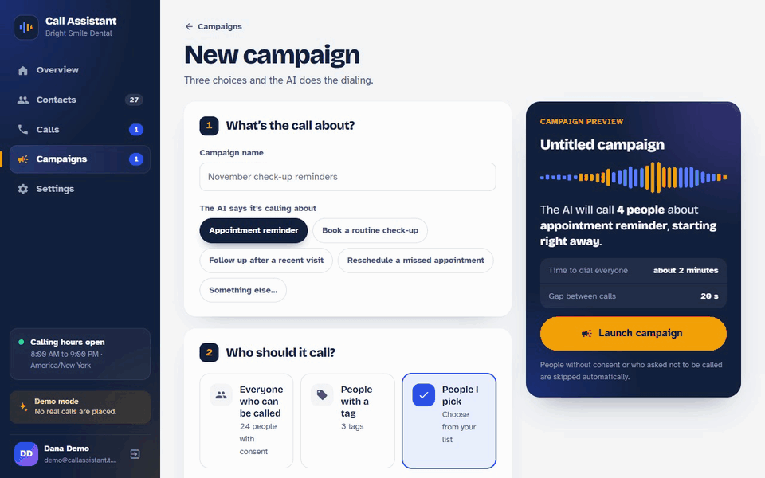

*A campaign launched for four contacts: the page fills in by itself as each call ends. [Watch it as a video](docs/demo.mp4).*

Every call is drawn as a **voice fingerprint**: cobalt bars for the AI receptionist, saffron for the caller, sized from what each person said. Point at any part of it to find that moment in the conversation.

| Overview | A campaign, live |
| --- | --- |
| 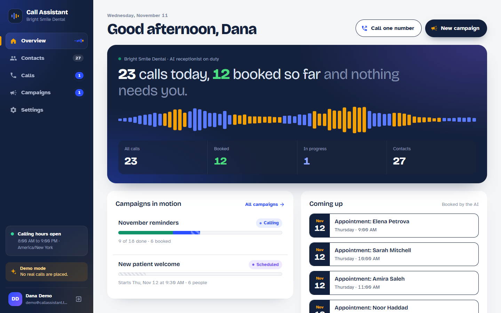 | 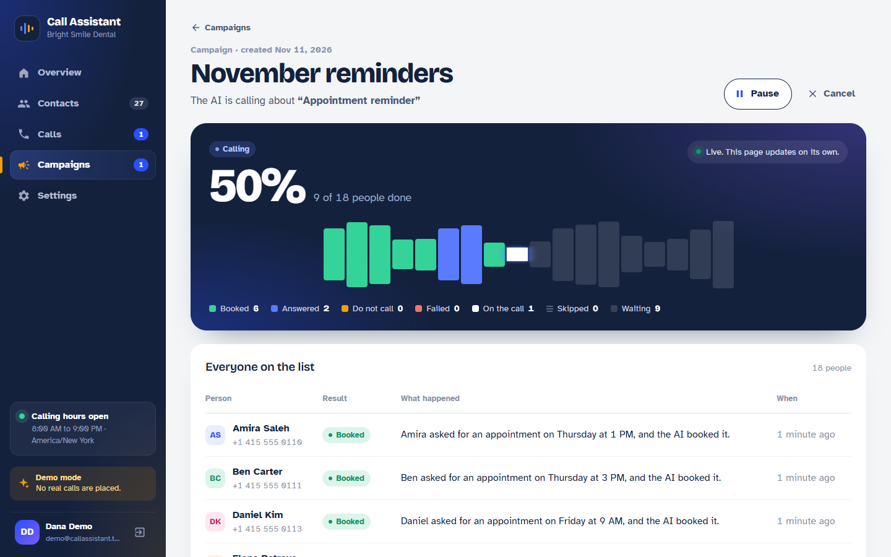 |
| **Call desk** | **Building a campaign** |
| 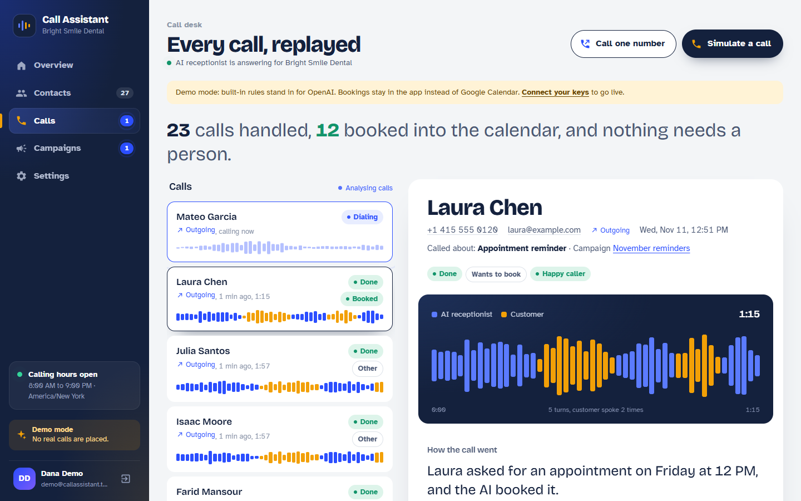 | 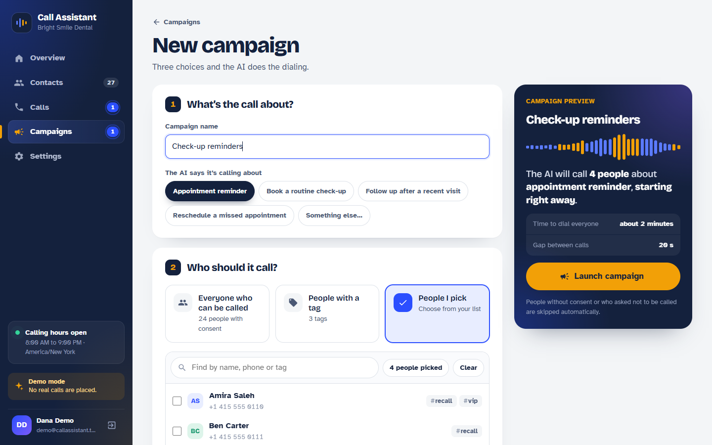 |
| **Contacts** | **Sign in** |
| 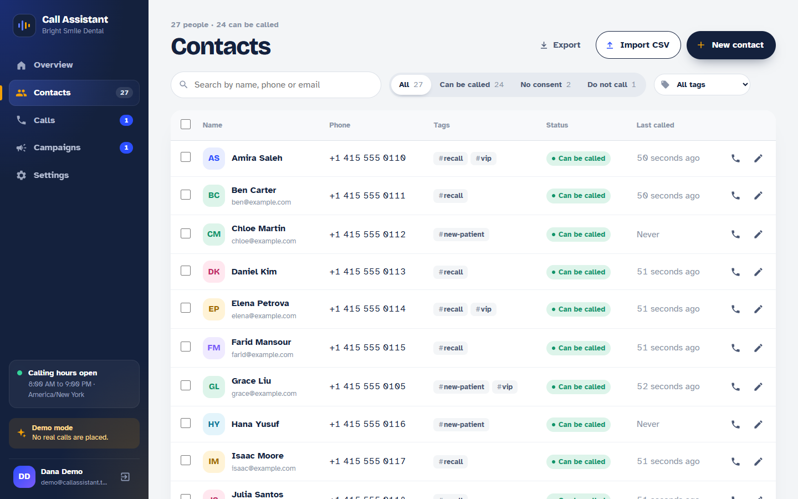 | 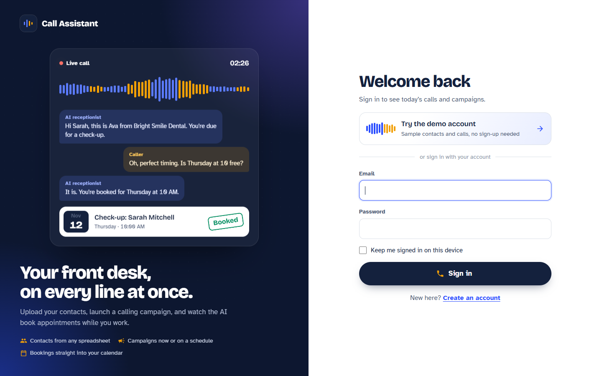 |

On a phone:

<p>
  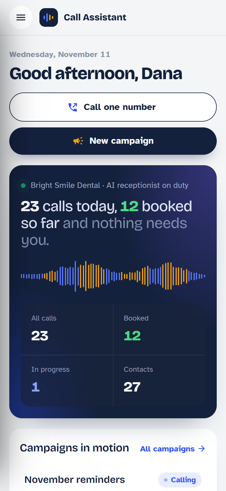
  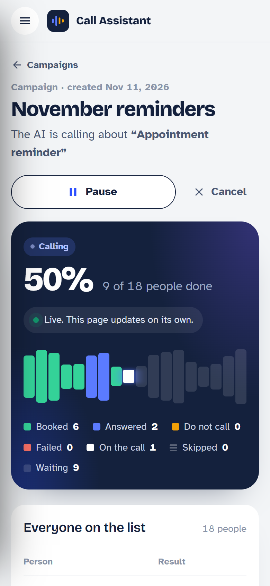
  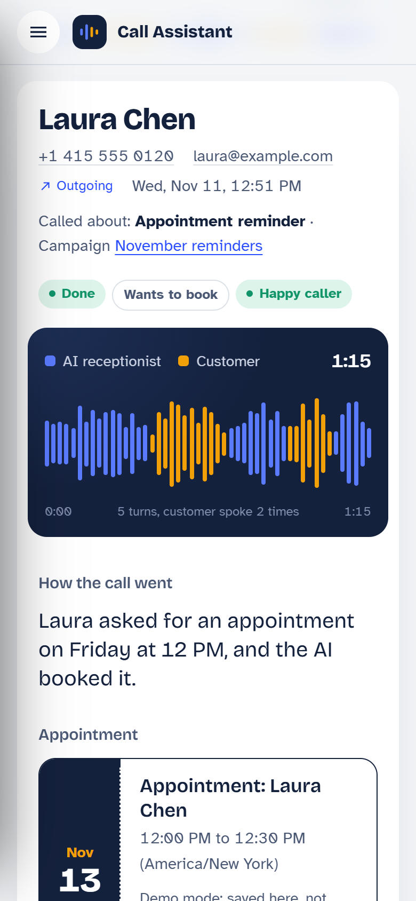
</p>

## What it does

1. **Accounts.** Sign up with your business name; the AI introduces itself with it on every call. Each account only ever sees its own contacts, calls and campaigns, and gets its own webhook URL.
2. **Contacts.** Import a CSV from Excel or Google Sheets (with a report of every skipped row), or add, edit and delete people one by one. Tag them, search and filter by status or tag, select several at once, and export everything back to CSV.
3. **Campaigns.** Pick who to call (people you choose, everyone with a tag, or everyone with consent) and what about, then start right away or schedule a date and time. The AI calls them one after another, waits for calling hours instead of skipping anyone, and can be paused, resumed or cancelled. A live page shows every person's result as it happens: booked, answered, asked not to be called, failed or skipped.
4. **Receives calls** at the account's signed webhook, validates the payload, ignores duplicate deliveries and queues the work, so the voice provider never times out.
5. **Analyses each call with OpenAI**: a short summary, the caller's intent and sentiment, follow-up tasks for staff, and any appointment time that was agreed. Relative dates such as "tomorrow at 10" are resolved in the business's timezone.
6. **Books Google Calendar**: checks free/busy first, so a slot taken in the meantime is flagged instead of double-booked, then creates the event with the caller's details and the call summary.
7. **Shows everything on a live call desk**: each call's voice fingerprint, the AI summary, the booked appointment and the full conversation, updating live, with a retry button for anything that failed. One number can also be called straight from here.

It runs in **demo mode** with no accounts at all: simple built-in rules stand in for OpenAI, and bookings are recorded locally instead of in Google Calendar. Add the keys and the same code paths call the real services.

## How it fits together

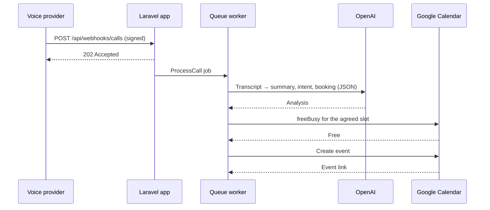

## Quick start

Requirements: PHP 8.2+, Composer, SQLite.

```bash
git clone https://github.com/<your-username>/ai-call-assistant.git
cd ai-call-assistant
./install.sh
```

`install.sh` adds the standard Laravel 12 skeleton around this project's files, installs dependencies, creates `.env` with a random webhook secret, and seeds a demo account with sample contacts and calls.

Then run these in two terminals:

```bash
php artisan serve        # the app at http://localhost:8000
php artisan queue:work   # places calls, runs campaigns, analyses calls
```

On the sign-in page press **Try the demo account**, or create your own account. On the call desk press **Simulate a call**, or run `php artisan calls:simulate`. Set `CALL_ASSISTANT_DEMO_LOGIN=false` to hide the demo account on a real deployment.

Campaigns, including scheduled ones, run on the queue worker alone: no cron job is needed.

## Connecting the real services

### OpenAI

```env
OPENAI_API_KEY=sk-...
OPENAI_MODEL=gpt-4o-mini
CALL_ASSISTANT_TIMEZONE=America/New_York
```

### Google Calendar

1. In Google Cloud, enable the **Google Calendar API** and create a **service account**. Download its JSON key.
2. Save the key as `storage/app/private/google-service-account.json` (this folder is git-ignored).
3. In Google Calendar, open the calendar's **Settings and sharing**, and share it with the service account's email with **Make changes to events**.
4. Copy the **Calendar ID** from the same page into `.env`:

```env
GOOGLE_CALENDAR_ID=your-calendar-id@group.calendar.google.com
```

The app signs in with the service account using a signed JWT, so no Google SDK is needed.

### Outgoing calls (Vapi)

1. In [Vapi](https://vapi.ai), create an assistant and import or buy a phone number. In the assistant's prompt you can use `{{customer_name}}`, `{{purpose}}` and `{{business_name}}`; the app fills them in for each call.
2. Set the assistant's server URL to a relay that turns Vapi's end-of-call report into this app's webhook format (below), using Vapi's call `id` as `call_id`.
3. Add the keys:

```env
VAPI_API_KEY=...
VAPI_ASSISTANT_ID=...
VAPI_PHONE_NUMBER_ID=...
```

Without them, outgoing calls run in demo mode: nobody is called, and a sample conversation comes back after a few seconds.

**Who gets called.** The app protects the business and the people on the list:

- A contact is only called if consent is on record: confirmed when adding them, for the whole CSV, or on the contact form (where it can also be withdrawn).
- Anyone who asks the AI not to be called again is blocked automatically, and stays blocked even if they are re-imported. Campaigns check this again right before each call.
- Calls only go out within calling hours (`OUTBOUND_CALLING_HOURS_START` and `_END`, in the business timezone). A campaign that reaches the end of the day waits and continues at the next opening. Laws also count the person's own local time, so set these hours for where your contacts are.
- Campaign calls go out one at a time, `OUTBOUND_SECONDS_BETWEEN_CALLS` apart (20 seconds by default).

Rules on automated calls differ by country (for example the TCPA in the United States). Check what applies to you before calling real numbers.

**CSV format.** A header row with `name` and `phone` (also accepted: "phone number", "mobile"), and optionally `email`, `notes` and `tags` (comma-separated inside the cell). A file exported from the Contacts page imports again as it is. Commas or semicolons both work. Numbers need a country code (`+962 79 123 4567`), unless you set `OUTBOUND_DEFAULT_COUNTRY_CODE`. Rows with an invalid number are skipped and listed back to you. See `public/samples/contacts-example.csv`.

## Webhook API

`POST /api/webhooks/calls/{token}`

Each account has its own URL, shown (with a copy button) on the **Settings** page, so incoming calls land in the right account. A finished outbound call that the app placed can also be reported to `POST /api/webhooks/calls` without the token, since the app already knows whose call it is.

| Header | Value |
| --- | --- |
| `Content-Type` | `application/json` |
| `X-Signature` | `sha256=` + HMAC-SHA256 of the raw body, keyed with `CALL_WEBHOOK_SECRET` |

```json
{
  "call_id": "call_8f2k1",
  "direction": "inbound",
  "duration_seconds": 146,
  "started_at": "2026-11-10T08:55:00-05:00",
  "caller": { "name": "Sarah Mitchell", "phone": "+1 415 555 0142", "email": "sarah@example.com" },
  "transcript": [
    { "role": "agent", "text": "Bright Smile Dental, how can I help?" },
    { "role": "caller", "text": "I'd like to book a cleaning tomorrow at 10 AM." }
  ]
}
```

Responses: `202` accepted (also for a repeated `call_id`), `401` bad signature, `404` unknown account URL, `422` invalid payload or a new call sent without an account URL.

Send a signed sample from the command line:

```bash
scripts/send-sample-webhook.sh http://localhost:8000
```

**Using a voice provider.** Point the provider's end-of-call webhook here. If its payload has a different shape, map it to the format above in `CallWebhookController`, or with a small relay in front of this app.

## Tests

```bash
php artisan test
```

55 feature tests fake OpenAI, Google and Vapi with `Http::fake()`. They cover:

- **Accounts:** sign up, sign in and out, validation, settings, and that no account can see or change another's contacts, calls or campaigns.
- **Contacts:** CSV import (Excel's semicolons and byte-order mark, tags, re-imports that update instead of duplicating), the add/edit form, duplicate numbers, search and filters, bulk delete, and CSV export.
- **Calls:** signature checks, per-account webhook URLs, validation, the full booking flow, conflict detection, duplicate webhooks, times in the past, OpenAI failures and retries, demo mode, consent, opt-outs, calling hours, and placing a call through Vapi.
- **Campaigns:** starting now, scheduled starts (including the time zone), tag and "everyone" audiences, pause and resume, cancel, waiting for calling hours, opt-outs mid-campaign, recovering a stalled campaign, and never ringing someone twice.

## Project structure

```
app/
  Models/User.php                 An account: business name, webhook URL, contact tags
  Models/Contact.php              Contacts: CSV import/export, phone formats, tags, consent, opt-outs, calling hours
  Models/Campaign.php             Campaigns: launch, run one call per step, pause/resume/cancel, progress
  Models/CampaignRecipient.php    One person on a campaign's list and their result
  Models/Call.php                 Call lifecycle: dialing, webhook intake, OpenAI analysis, dashboard data
  Models/Appointment.php          Google Calendar: service-account auth, free/busy, events
  Models/Concerns/BelongsToUser.php  Keeps every record inside its account
  Jobs/RunCampaign.php            One campaign step
  Jobs/ProcessCall.php            Queued call analysis
  Jobs/DeliverDemoOutcome.php     Demo mode stand-in for the provider's webhook
  Http/Controllers/               Auth, Dashboard, Contact, Call, Campaign, Settings, Api/CallWebhook
config/call_assistant.php         Settings, demo account and sample calls
resources/views/                  Blade pages: auth, dashboard, contacts, calls, campaigns, settings
public/js/app.js                  jQuery for every page
public/js/dashboard.js            jQuery call desk
public/css/app.css                App design (built on dashboard.css)
tests/Feature/                    Auth, Contact, OutboundCall, CallWebhook and Campaign tests
```

## Design notes

- **Thin controllers, logic in models.** Controllers only validate input and call the model, so the same flow serves the webhook, the dashboard, the artisan command and the seeder.
- **Never trust the model's output.** The AI response is parsed as JSON and normalised: unknown intents fall back to `other`, empty action items are dropped, and a booking time that cannot be parsed or is in the past is never booked.
- **Safe to retry.** Webhooks are idempotent by `call_id`, a call is never processed twice, and an appointment is never sent to the calendar twice.
- **Campaigns without cron.** A campaign is a chain of queued steps, one call each. Every start or resume issues a new run token and a step with an old token does nothing, so pausing and resuming can never leave two chains calling at once. A person is marked as called before the call is placed, so a retried step never rings them twice.
- **Accounts by construction.** Route model binding only finds records owned by the signed-in user, so another account's ID is a plain 404 everywhere.
- **Failures stay visible.** OpenAI or Google errors are stored on the call or appointment and shown on the dashboard, with a retry button, instead of disappearing into a log.

## License

MIT
